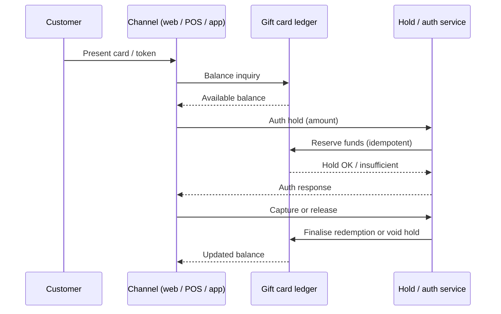

# Gift Card Omnichannel Redemption

An educational guide to **redeeming the same gift card** online, at in-store POS, and in-app while keeping **balance consistency** across channels. Written for retailers, fintechs, and product teams looking at platforms in the [EVD System](https://evdsystem.com/) and [MoboGage](https://evdsystem.com/about-mobogage/) family.

---

## What Is Omnichannel Gift Card Redemption?

**Omnichannel redemption** means one gift-card instrument (PAN/PIN, barcode, or tokenised account) can be spent in every channel the program supports — e-commerce, store POS, and mobile app — with a single source of truth for remaining balance.

Without a shared ledger and clear hold/capture rules, customers see "balance available" online while a cashier is already capturing the same funds, or partial redemptions diverge across systems. Omnichannel design prevents that double-spend class of failure.

### Typical use cases

- **Retailers** accepting the same card in store and on the website
- **Marketplaces** redeeming closed-loop cards inside an app wallet view
- **Hospitality and QSR** splitting tips or tickets across POS and mobile order-ahead
- **Operators** reconciling multi-channel redemptions back to one card account

---

## How It Works

### Core components

| Component | Responsibility |
|-----------|----------------|
| **Card account ledger** | Single balance and status for the gift card |
| **Channel adapters** | POS ISO/API, e-commerce plugin, in-app SDK calling the same APIs |
| **Hold / auth service** | Soft-reserves amount so parallel channels cannot overspend |
| **Idempotency keys** | Prevent duplicate capture on retries |
| **Partial redemption rules** | Allow spend less than face value; update remaining balance |
| **Reconciliation** | Matches channel settlement files to ledger captures |

See [docs/omnichannel-redemption-checklist.md](./docs/omnichannel-redemption-checklist.md) for a channel go-live checklist.

---

## Balance Consistency Essentials

| Concern | Practice |
|---------|----------|
| **Source of truth** | One ledger; channels never keep a writable local balance |
| **Holds** | Time-bound reservations with automatic expiry |
| **Partial spend** | Always return remaining balance after capture |
| **Offline POS** | Prefer store-and-forward with strict limits, or decline when offline |
| **Status codes** | Active, frozen, expired, depleted — same everywhere |
| **Customer view** | App/web balance matches what POS would see within hold windows |

---

## Design Considerations

- **Auth then capture.** Do not debit on inquiry; debit (or hold) only when the sale is confirmed.
- **Hold TTLs matter.** Too long blocks legitimate spend elsewhere; too short causes mid-checkout failures.
- **Idempotent captures.** Network retries at POS and web must not double-redeem.
- **Tokenise for digital channels.** Prefer tokens over raw PAN/PIN in browsers and apps.
- **Explain partial redemption.** Receipts and UI should show amount used and amount left.
- **Freeze consistently.** A fraud freeze must hit all channels within seconds, not overnight batch.
- **Test cross-channel races.** Script concurrent web + POS spends against the same card in QA.

EVD System and MoboGage treat gift cards and electronic vouchers as managed instruments with inventory, PIN security, and redemption controls — the same discipline that keeps multi-channel balances honest.

---

## FAQ

**Can one gift card be used online and in-store?**
Yes, if both channels call the same ledger with hold/capture semantics. That is the core of omnichannel redemption.

**What causes balance mismatch?**
Local caches, missing holds, duplicate captures on retry, or offline POS posting late. Fix the architecture, not just the display.

**Should inquiry lock the balance?**
Usually no. Use a short hold only when the customer commits to a purchase amount.

**How do partial redemptions work?**
Capture the purchase amount up to available balance; leave the remainder active unless the program forces full burn.

**How does this relate to MoboGage / EVD System?**
MoboGage provides voucher and gift-card style instruments within EVD System. See [voucher management system](https://evdsystem.com/voucher-management-system-mobogage/) and [what is an electronic voucher](https://evdsystem.com/evd-software/what-is-an-electronic-voucher/).

**What about expired cards mid-checkout?**
Re-check status at capture time; expired or frozen cards must fail consistently across channels.

---

## Glossary (short)

- **Omnichannel redemption** — spending one card instrument across web, POS, and app
- **Hold / auth** — temporary reservation of balance before final capture
- **Partial redemption** — spending less than the full remaining balance
- **Idempotency key** — client key that makes retries safe
- **Closed-loop** — card spendable only within the program's merchant set

---

## Further Reading / Related Industry Resources

- [Voucher management system (MoboGage)](https://evdsystem.com/voucher-management-system-mobogage/) — voucher and gift-card management context
- [What is an electronic voucher?](https://evdsystem.com/evd-software/what-is-an-electronic-voucher/) — instrument basics
- Related repo: [gift-card-partial-redemption](https://github.com/iwtglobal/gift-card-partial-redemption) — partial spend patterns for gift cards

---

## License

Documentation in this repository is provided under the MIT License. See [LICENSE](./LICENSE).

*Educational material only. Not legal, regulatory, or financial advice. MoboGage and EVD System refer to offerings on evdsystem.com.*
